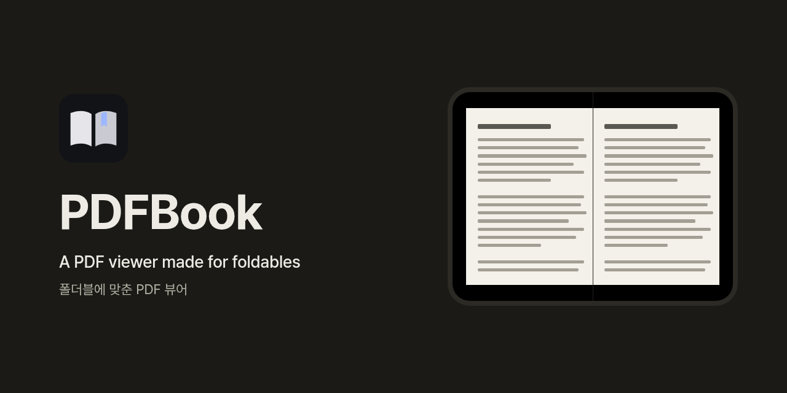
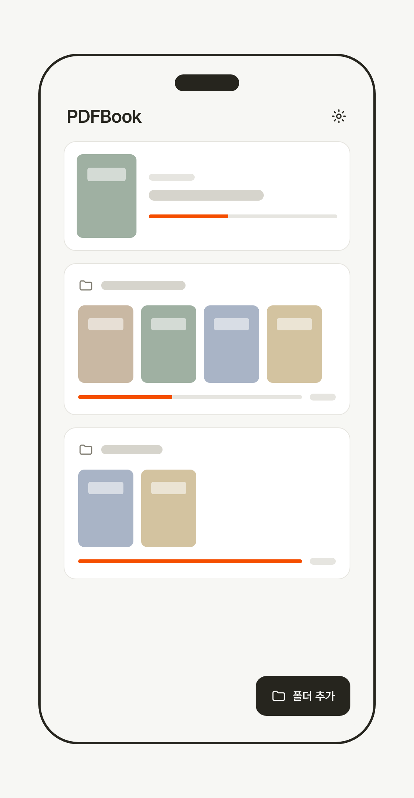
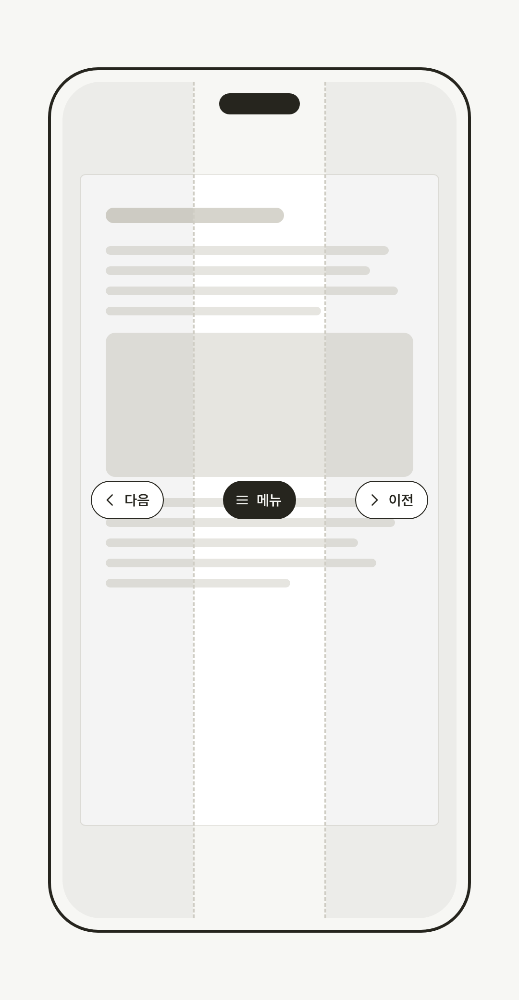
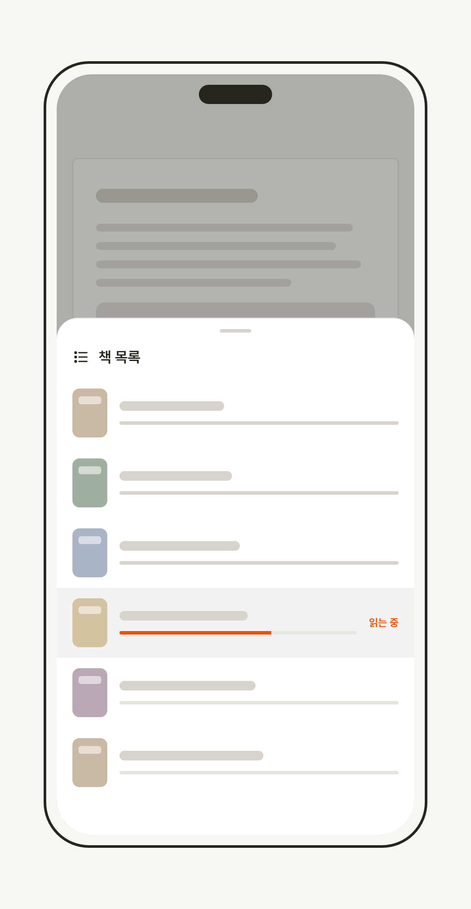

# PDFBook

안드로이드 PDF 책 뷰어.

휴대폰에 있는 PDF 책을 폴더째 등록해 두고, 서재처럼 골라 읽는 앱입니다. 폴더블 기기의 펼친 화면에서는 두 쪽을 나란히 보여 줍니다.

  
  
  

## 주요 기능

- **여러 폴더와 하위 폴더** — 책 폴더를 여러 개 등록하고 순서를 바꿀 수 있어요. 폴더 안의 하위 폴더도 서재에서 바로 열립니다.
- **이어 읽기** — 마지막으로 읽던 책과 쪽에서 다시 시작해요.
- **넘김 방향** — 오른쪽 → 왼쪽, 왼쪽 → 오른쪽 중에서 고르고, 책마다 따로 기억해요.
- **두쪽 보기** — 자동 / 항상 한쪽 / 항상 두쪽. 표지만 따로 한 쪽에 보여 줄 수도 있어요.
- **확대** — 두 손가락으로 확대하거나 두 번 탭해서 확대해요.
- **탭 영역과 볼륨 키** — 화면 왼쪽·가운데·오른쪽을 탭해 넘기거나 메뉴를 열어요. 양쪽 영역의 폭을 조절할 수 있고, 볼륨 키로도 넘길 수 있어요.
- **이전 권 / 다음 권, 책 목록** — 같은 폴더의 다음 권으로 바로 넘어가고, 목록에서 권별 진행률을 확인해요.
- **숨긴 항목** — 보고 싶지 않은 폴더나 책을 앱에서만 가려요. 파일은 지워지지 않아요.
- **앱 잠금** — PIN 또는 생체 인증(지문·얼굴)으로 잠가요.
- **최근 앱 화면 가리기** — 최근 앱 화면에서 읽던 내용을 가려요.
- **라이트 / 다크 테마, 한국어 / English**

## 설치

1. [최신 릴리스](https://github.com/parkjangwon/pdfbook/releases/latest)에서 `pdfbook-<버전>.apk` 파일을 받습니다.
2. 받은 파일을 엽니다. 처음이면 Android가 "출처를 알 수 없는 앱" 설치를 막는데, 안내에 따라 파일을 연 앱(브라우저나 파일 관리자)에 **이 출처 허용**을 켜고 다시 설치하면 됩니다.
3. 앱을 열고 PDF가 들어 있는 폴더를 고르면 끝입니다.

**Android 15 이상**이 필요합니다.

## 업데이트

- 설정 → 업데이트에서 **업데이트 확인**을 누르면 새 버전이 있는지 봅니다. 새 버전이 있으면 **받고 설치하기**를 눌러 앱 안에서 바로 설치할 수 있어요.
- **자동으로 업데이트 확인**을 켜 두면(기본값) 앱을 켤 때 하루 한 번 확인합니다. 끌 수 있어요.
- 받은 파일은 지금 설치된 앱과 서명이 같은지 확인한 뒤에만 설치합니다.
- 앱 안에서 설치하려면 처음 한 번 PDFBook의 "앱 설치 허용"이 필요해요.
- 새 버전은 보통 매주 금요일에 나옵니다.

## 개인정보

- 계정이 없고, 사용 기록이나 개인정보를 수집하거나 보내지 않습니다. 분석·광고·오류 보고 도구도 들어 있지 않아요.
- 인터넷은 **업데이트를 확인하고 새 버전을 받을 때만** 씁니다. 이때 GitHub(이 저장소의 Releases)에만 접속해요.
- 폴더 목록, 읽던 위치, 설정은 기기 안에 저장되고 앱이 어디로도 보내지 않습니다. (Android 기기 백업을 켜 두었다면 시스템 백업에 포함될 수 있어요.)
- 고른 폴더에는 읽기 권한만 받습니다. PDF 파일을 고치거나 지우지 않아요.
- 앱이 요청하는 권한:
  - 인터넷 — 업데이트 확인과 다운로드
  - 앱 설치 요청 — 받은 업데이트 설치
  - 생체 인증 — 앱 잠금을 생체 인증으로 쓸 때

## 라이선스

[MIT License](LICENSE). 앱에 들어 있는 폰트(Pretendard 기반 PDFBook Sans, JetBrains Mono)는 SIL Open Font License 1.1을 따르며, 전문은 [licenses/](licenses/)에 있습니다. 앱의 설정 → 오픈소스 라이선스에서도 볼 수 있어요.

## English

PDFBook is a PDF book reader for Android (Android 15 or later).

- Add multiple book folders (with subfolders) and resume where you left off.
- Right-to-left or left-to-right page turning, remembered per book; single or two-page view with an optional standalone cover.
- Pinch and double-tap zoom, adjustable tap zones, volume-key page turning.
- Previous/next volume buttons and a book list, hidden items, app lock (PIN or biometrics, hide content in Recents), light/dark themes, Korean and English.
- Install: download the APK from [the latest release](https://github.com/parkjangwon/pdfbook/releases/latest) and allow installs from that source when Android asks.
- Updates: check from Settings, or automatically once a day on launch (can be turned off). New versions usually ship on Fridays.
- Privacy: no accounts, no analytics, no data collection. The app connects to the internet only to check for and download updates from GitHub Releases.
- License: MIT. Bundled fonts are under the SIL Open Font License 1.1.

## 개발

빌드와 기여 방법은 [CONTRIBUTING.md](CONTRIBUTING.md)를 참고하세요.
